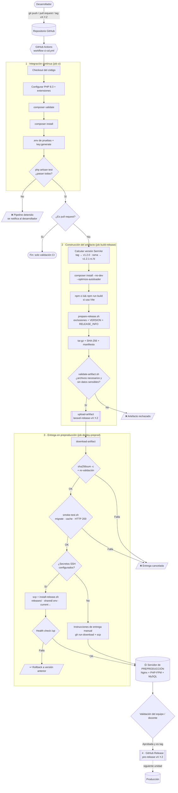

# Parte 1. Diseño del proceso de liberación

> **Alumno:** <TU NOMBRE COMPLETO> · **Matrícula:** <TU MATRÍCULA> · **Grupo:** <GRUPO>
> **Repositorio:** https://github.com/<TU_USUARIO>/<TU_REPOSITORIO>
> **Fecha:** <FECHA>

## 1.1 Pasos para preparar una versión liberable

| # | Paso | Herramienta / comando | Dónde se ejecuta |
|---|------|-----------------------|------------------|
| 1 | Obtener el código de la rama o tag | `actions/checkout@v4` | Job `ci` y `build-release` |
| 2 | Validar dependencias declaradas | `composer validate` | Job `ci` |
| 3 | Instalar dependencias completas (incluye desarrollo) | `composer install` | Job `ci` |
| 4 | Ejecutar pruebas automatizadas | `php artisan test` | Job `ci` |
| 5 | Calcular la versión (SemVer) | `scripts/version.sh` | Job `build-release` |
| 6 | Instalar **solo** dependencias de producción | `composer install --no-dev --optimize-autoloader` | Job `build-release` |
| 7 | Compilar recursos front-end (si usa Vite) | `npm ci && npm run build` | Job `build-release` |
| 8 | Copiar archivos aplicando exclusiones, agregar `VERSION` y `RELEASE_INFO.json` | `scripts/prepare-release.sh` + `.releaseignore` | Job `build-release` |
| 9 | Comprimir, calcular SHA-256 y manifiesto | `tar -czf`, `sha256sum` | Job `build-release` |
| 10 | Validar el contenido del paquete | `scripts/validate-artifact.sh` | Job `build-release` |
| 11 | Publicar el artefacto de la ejecución | `actions/upload-artifact@v4` | Job `build-release` |
| 12 | Descargar, verificar integridad y re-validar | `actions/download-artifact@v4`, `sha256sum -c` | Job `deploy-preprod` |
| 13 | Prueba de instalación en ambiente efímero | `scripts/smoke-test.sh` | Job `deploy-preprod` |
| 14 | Entregar en el servidor de preproducción | `scp` + `scripts/install-release.sh` | Job `deploy-preprod` |
| 15 | (Solo tags) Publicar la versión como *pre-release* | `gh release create` | Job `github-release` |

## 1.2 Archivos y dependencias necesarios en otro entorno

**Se incluyen en el artefacto**

| Elemento | Motivo |
|----------|--------|
| `app/`, `bootstrap/app.php`, `config/`, `routes/`, `resources/views/`, `lang/` | Código y configuración de la aplicación |
| `database/migrations/`, `database/seeders/` | Crear/actualizar el esquema en la BD de preproducción |
| `public/` (incluye `public/build/` compilado) | Punto de entrada web y recursos estáticos |
| `vendor/` (sin `require-dev`) | Dependencias PHP de producción ya resueltas |
| `artisan`, `composer.json`, `composer.lock` | Consola de Laravel y versiones exactas de dependencias |
| `storage/` y `bootstrap/cache/` (**vacíos**, solo estructura) | Directorios que Laravel necesita escribibles |
| `.env.example` | Plantilla de variables (sin valores secretos) |
| `VERSION`, `RELEASE_INFO.json` | Trazabilidad: versión, commit, fecha, versión de PHP/Laravel |

**Se excluyen** (definidos en [`.releaseignore`](../.releaseignore)): `.git/`, `.github/`, `.env` y variantes, `node_modules/`, `tests/`, `phpunit.xml`, llaves `*.key/*.pem`, `auth.json`, bases SQLite, logs, sesiones, caché compilada y vistas compiladas, `public/storage` (enlace que se recrea en el servidor), `docs/` y `deploy/`.

**Dependencias del entorno destino:** PHP ≥ 8.2 (se usa 8.3) con extensiones `ctype, curl, dom, fileinfo, mbstring, openssl, pdo, pdo_mysql, tokenizer, xml, bcmath, intl, zip, gd`; servidor web (Nginx + PHP-FPM); MySQL 8; Composer (para mantenimiento). Detalle en [02-ambiente-preproduccion.md](02-ambiente-preproduccion.md).

## 1.3 Estrategia de identificación de versiones

Se usa **Versionado Semántico** `vMAJOR.MINOR.PATCH`:

| Cambio | Se incrementa | Ejemplo |
|--------|---------------|---------|
| Incompatible con versiones anteriores (rompe rutas, BD, API) | MAJOR | `v1.4.2 → v2.0.0` |
| Nueva funcionalidad compatible | MINOR | `v1.0.1 → v1.1.0` |
| Corrección de errores | PATCH | `v1.0.0 → v1.0.1` |

**Reglas automatizadas (`scripts/version.sh`):**

* **Versión candidata** – cada push a `main`/`develop` genera `v<siguiente PATCH>-rc.<número de ejecución>`.
  Ej.: si el último tag es `v1.0.0`, la ejecución 37 produce **`v1.0.1-rc.37`**.
* **Versión final** – al crear y empujar un tag se libera exactamente ese número:
  ```bash
  git tag -a v1.0.0 -m "Primera versión liberable"
  git push origin v1.0.0
  ```
  El tag debe cumplir `^v\d+\.\d+\.\d+$`; si no, el pipeline falla.
* El nombre del artefacto incluye la versión: `laravel-release-v1.0.0.tar.gz`.

## 1.4 Criterios para generar un artefacto de liberación (*quality gates*)

El artefacto **solo** se genera y entrega si se cumplen todos:

1. `composer.json`/`composer.lock` válidos y sincronizados.
2. El 100 % de las pruebas automatizadas (`php artisan test`) pasan.
3. La ejecución proviene de `main`, `develop`, un tag `vX.Y.Z` o una ejecución manual (no de un *pull request*).
4. Si es tag, cumple el formato SemVer.
5. `vendor/` instalado con `--no-dev` (sin `phpunit`, `mockery`, `faker`, `sail`, `collision`).
6. Si el proyecto usa Vite, existe `public/build/manifest.json`.
7. El validador no encuentra: `.env`, variantes `.env.*`, llaves privadas, `auth.json`, bases SQLite, logs, sesiones, `.git/`, `node_modules/`, ni patrones de credenciales (`APP_KEY` real, contraseñas asignadas, llaves AWS, tokens de GitHub).
8. Contiene todos los archivos necesarios (sección 1.2) y su SHA-256 coincide tras descargarse.
9. El smoke test instala el paquete, ejecuta migraciones, genera cachés y responde HTTP 2xx/3xx.

## 1.5 Diagrama del flujo CI → entrega en preproducción



> El diagrama se renderiza automáticamente en GitHub. Para exportarlo como imagen, pégalo en <https://mermaid.live> y descarga PNG/SVG en `docs/evidencias/diagrama-cd.png`.
